<div align="center">

# ⚔️ ASTRA: War of Lanka

**A 3D action game inspired by the Ramayana, played in the browser, with hidden-move duels on Solana powered by MagicBlock.**

[](https://sylvia-barick.github.io/astra/)
[](https://explorer.solana.com/address/CKEg1c51J8rK8pr3Ka8hNNMkarmUPjTf5UcHAH5THwnu?cluster=devnet)
[](https://docs.magicblock.gg)
[](https://threejs.org)

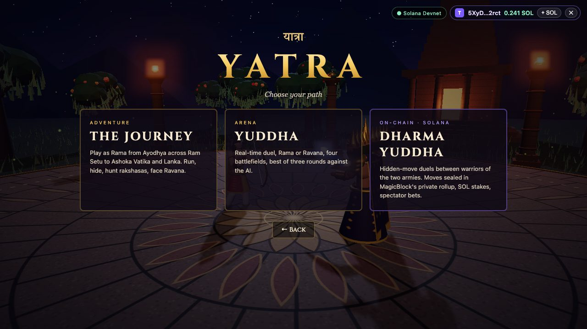

</div>

---

## Videos

| 🎬 Trailer (60 s) | 🎮 Full gameplay walkthrough (1:29, game sound) |
|---|---|
| [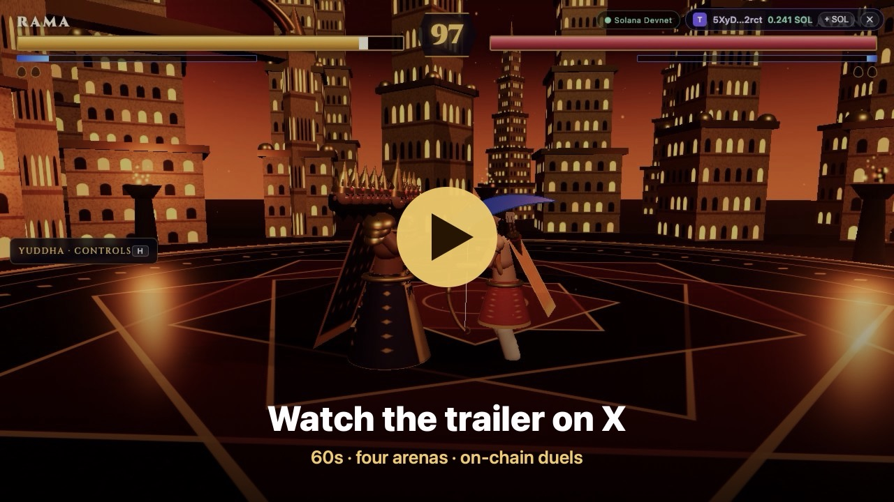](https://x.com/Sylviabarick/status/2125559198788505805) | [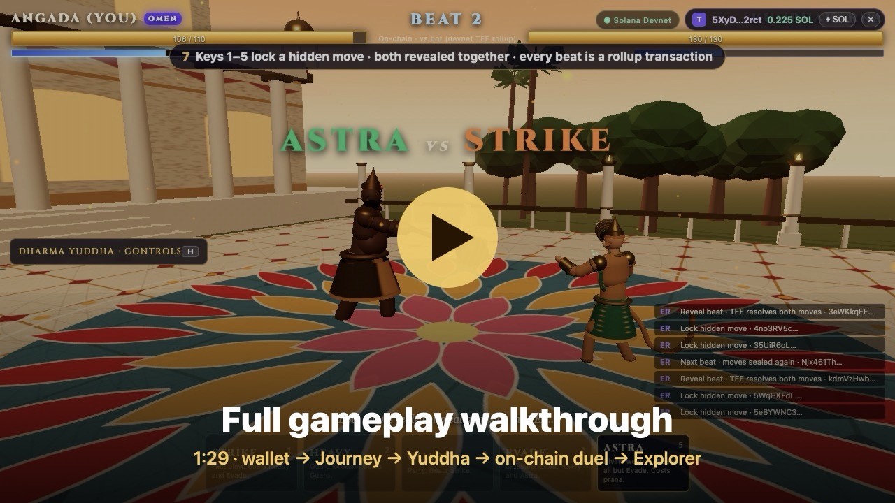](https://sylvia-barick.github.io/astra/media/astra-gameplay.mp4) |
| [▶ Watch on X](https://x.com/Sylviabarick/status/2125559198788505805) | [▶ Play the video](https://sylvia-barick.github.io/astra/media/astra-gameplay.mp4) (opens and plays in your browser) |

The walkthrough is one take through the real game: connect a wallet → BEGIN YATRA → The Journey → Yuddha → a real **on-chain Dharma Yuddha duel on devnet** → the payout transaction on Solana Explorer.

---

## Contents

1. [Videos](#videos)
1. [At a glance](#at-a-glance)
2. [Screenshots](#screenshots)
3. [Game modes and controls](#game-modes-and-controls)
4. [Player flow](#player-flow)
5. [Architecture](#architecture)
6. [On-chain duel lifecycle](#on-chain-duel-lifecycle)
7. [Smart contract](#smart-contract)
8. [Proof: live on Solana devnet](#proof-live-on-solana-devnet)
9. [Fairness, privacy and security](#fairness-privacy-and-security)
10. [Run it yourself](#run-it-yourself)
11. [Repository map](#repository-map)
12. [Respecting the epic](#respecting-the-epic)
13. [Roadmap](#roadmap)

---

## At a glance

| | |
|---|---|
| **Live game** | https://sylvia-barick.github.io/astra/ |
| **Trailer** | [Watch on X](https://x.com/Sylviabarick/status/2125559198788505805) |
| **Gameplay video** | [Play (1:29)](https://sylvia-barick.github.io/astra/media/astra-gameplay.mp4) |
| **Network** | Solana **devnet** |
| **Program ID** | [`CKEg1c51J8rK8pr3Ka8hNNMkarmUPjTf5UcHAH5THwnu`](https://explorer.solana.com/address/CKEg1c51J8rK8pr3Ka8hNNMkarmUPjTf5UcHAH5THwnu?cluster=devnet) |
| **Rollup** | MagicBlock Private Ephemeral Rollup (TEE): `devnet-tee.magicblock.app`, validator `MTEWGuqxUpYZGFJQcp8tLN7x5v9BSeoFHYWQQ3n3xzo` |
| **MagicBlock features used** | Delegation / commit / undelegate · TEE permissions (hidden state) · VRF · delegated lamports top-up |
| **Wallets** | Phantom, MetaMask, Core, Solflare, Backpack: anything that speaks the Solana Wallet Standard |
| **Stack** | Three.js + Vite (game) · Anchor 1.0.2 (program) · `ephemeral-rollups-sdk` 0.16 (Rust) / 0.14 (JS) · `@solana/web3.js` |
| **Tests** | Rust unit tests and JS tests check the same beat rules (the program and the browser must agree) |

---

## Screenshots

### 1 · Connect a wallet

The wallet bar sits on top of every screen. It finds any installed Solana wallet; if none is found, it links to install one.

| Connect menu | Connected · Yatra hub |
|---|---|
| 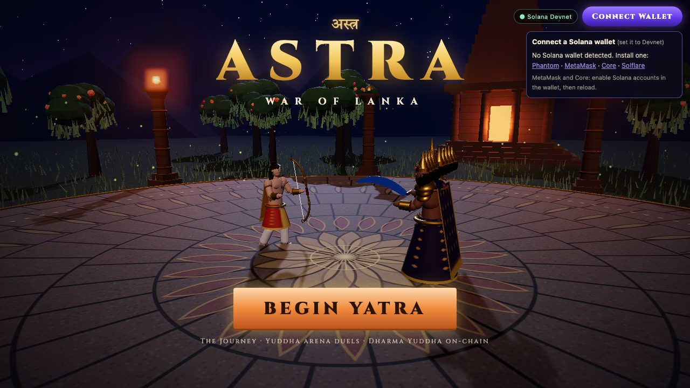 |  |

### 2 · The Journey (adventure)

Play as Rama from Ayodhya to Lanka. Run, hide in bushes, and shoot rakshasas who haven't seen you yet for triple damage. On the minimap, Rama is the **red dot**.

| Ayodhya: stealth and the minimap | Lanka: the Ravana boss |
|---|---|
| 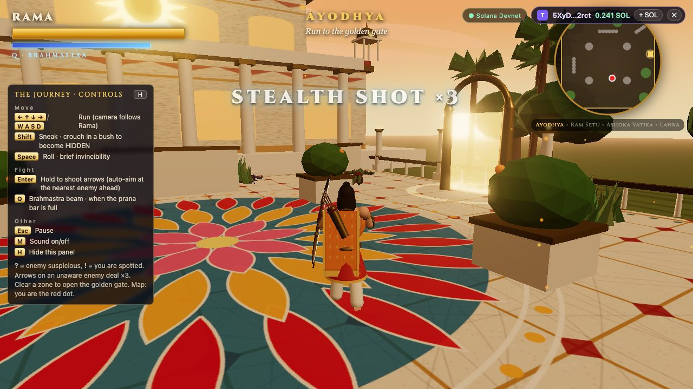 | 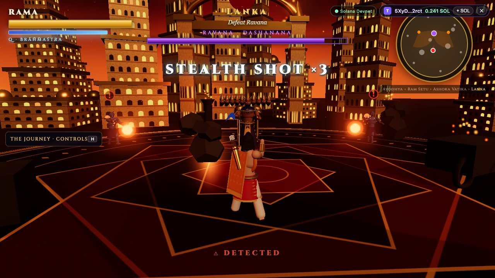 |

### 3 · Yuddha: four arenas

A real-time duel, Rama vs Ravana, best of three rounds against the AI.

| Ashoka Vatika | Ram Setu |
|---|---|
| 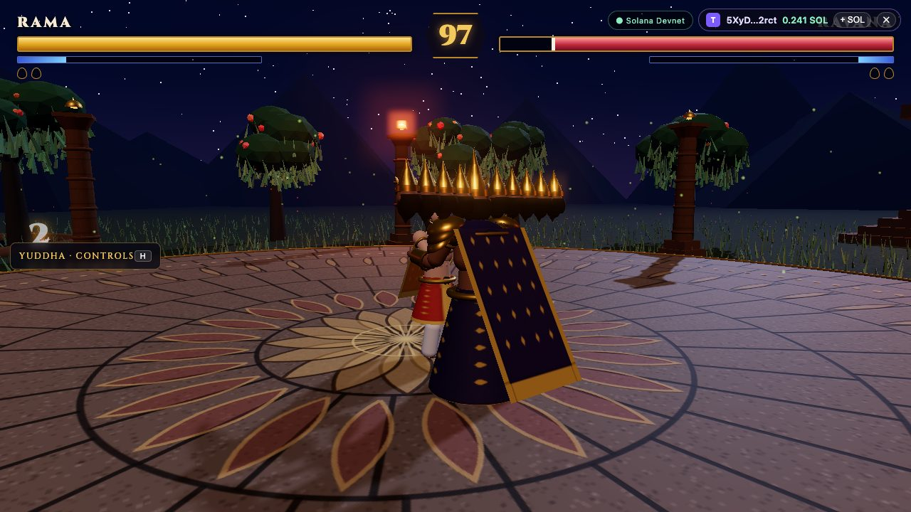 | 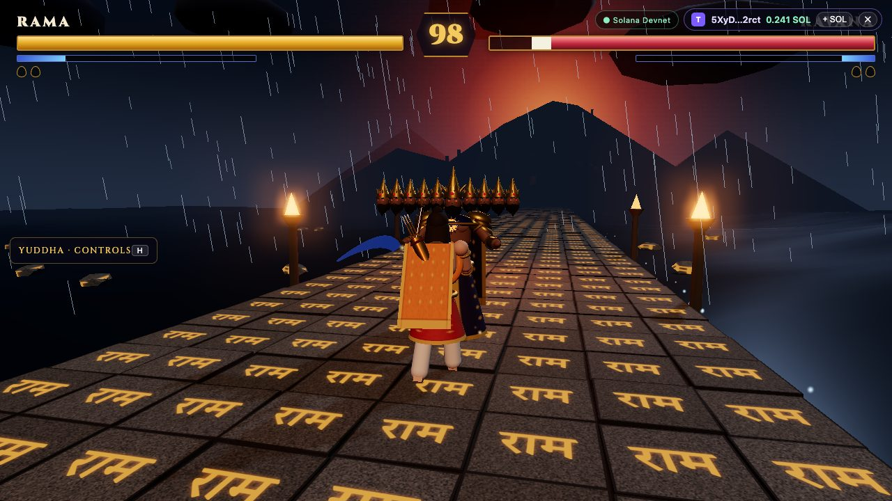 |
| **Lanka Dahan:** Chandrahasa Storm | **Ayodhya:** Brahmastra |
| 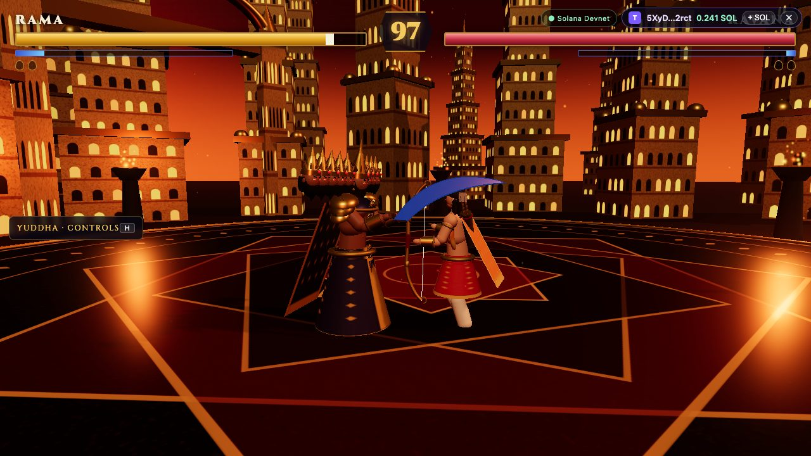 | 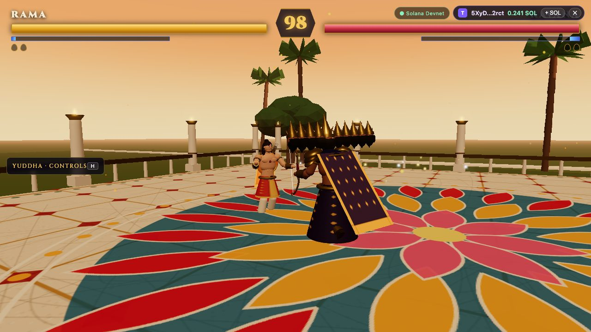 |

<p align="center">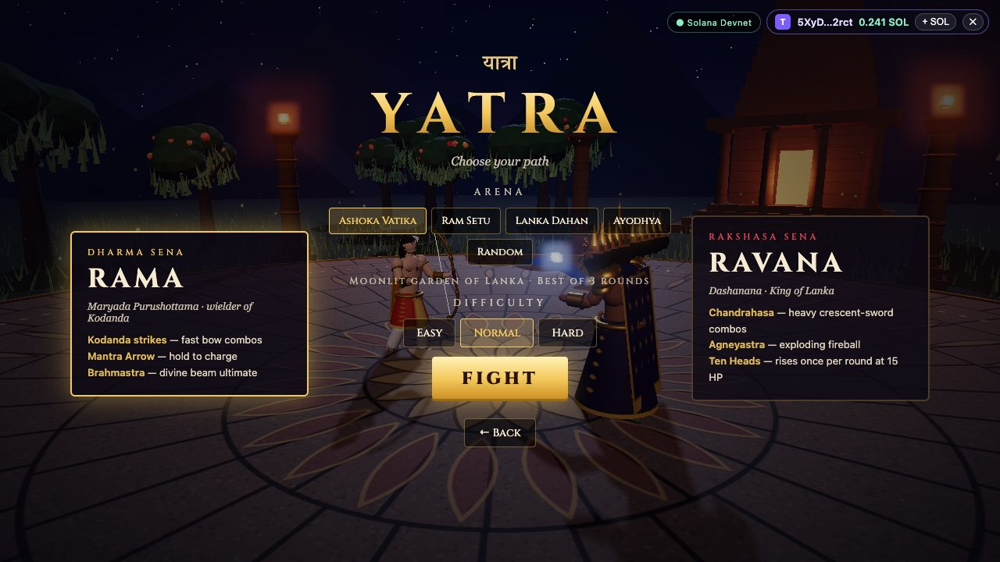</p>

### 4 · Dharma Yuddha: hidden-move duels

| Warriors of the two armies | A beat is revealed: HEAVY vs HEAVY |
|---|---|
| 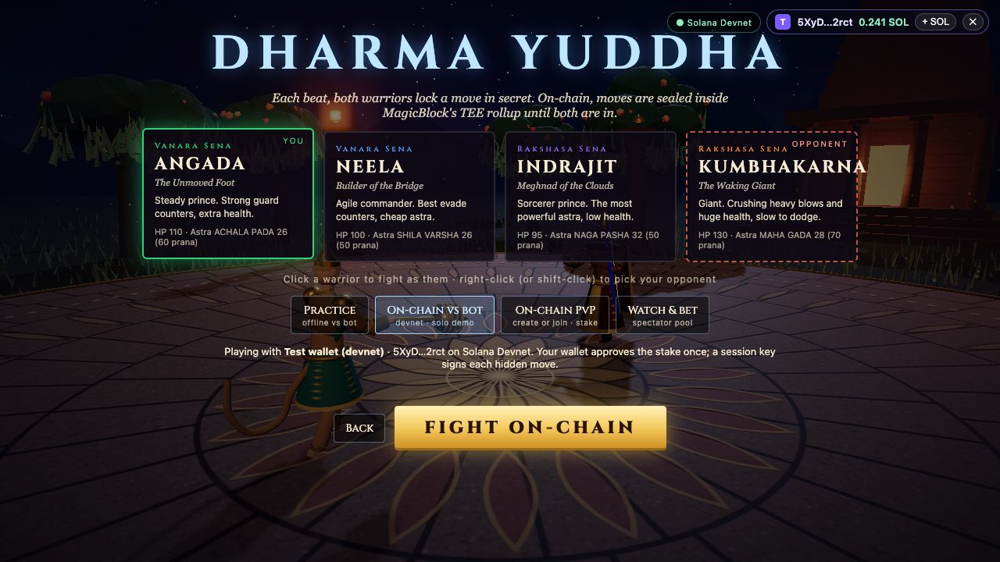 | 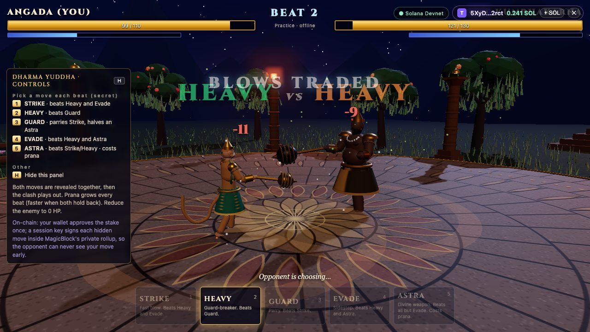 |

### 5 · On-chain, step by step (real devnet duel)

| ① Wallet approves once, duel moves to the private rollup | ② Every beat is a rollup transaction (log on the right) |
|---|---|
| 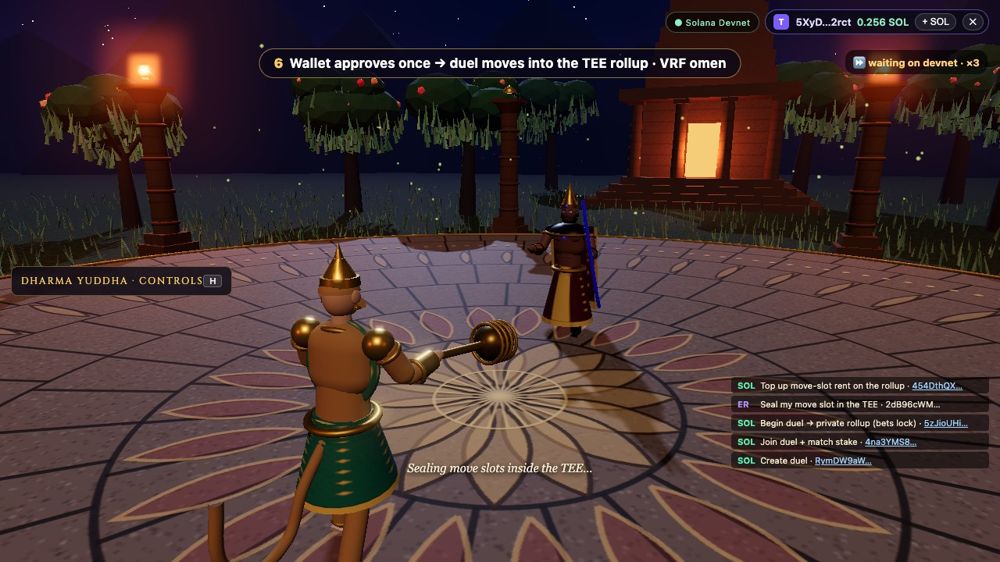 | 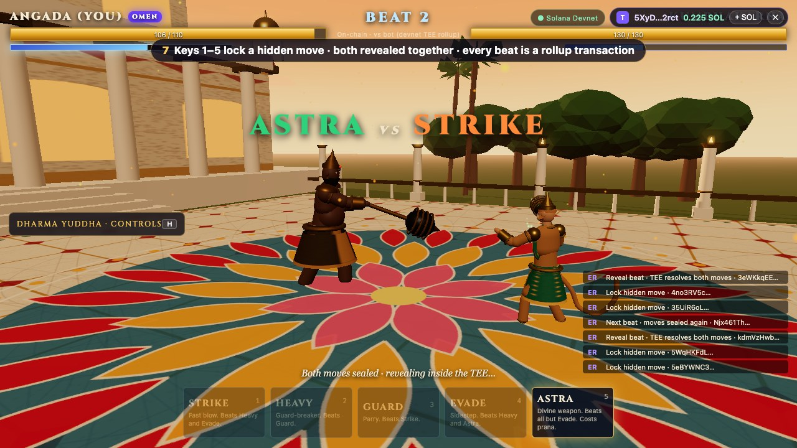 |
| **③ KO: result committed back to Solana, pot paid** | **④ The payout transaction on Solana Explorer** |
| 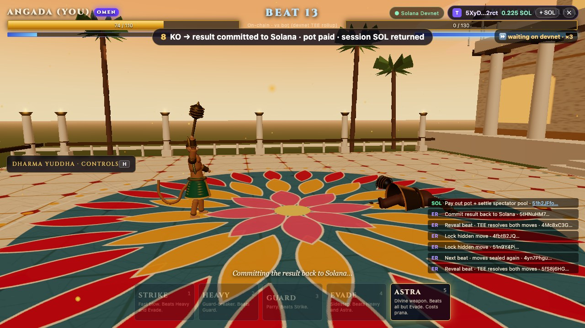 | 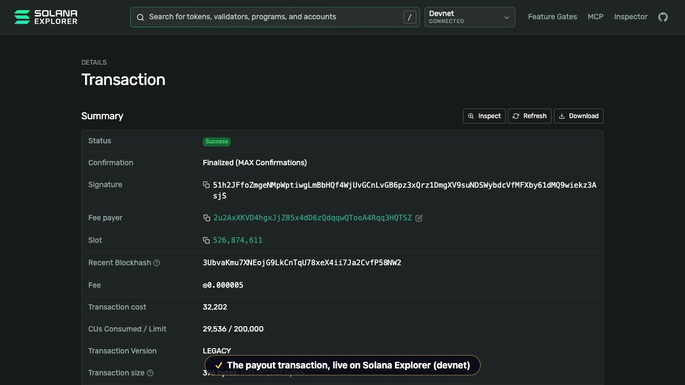 |

<p align="center">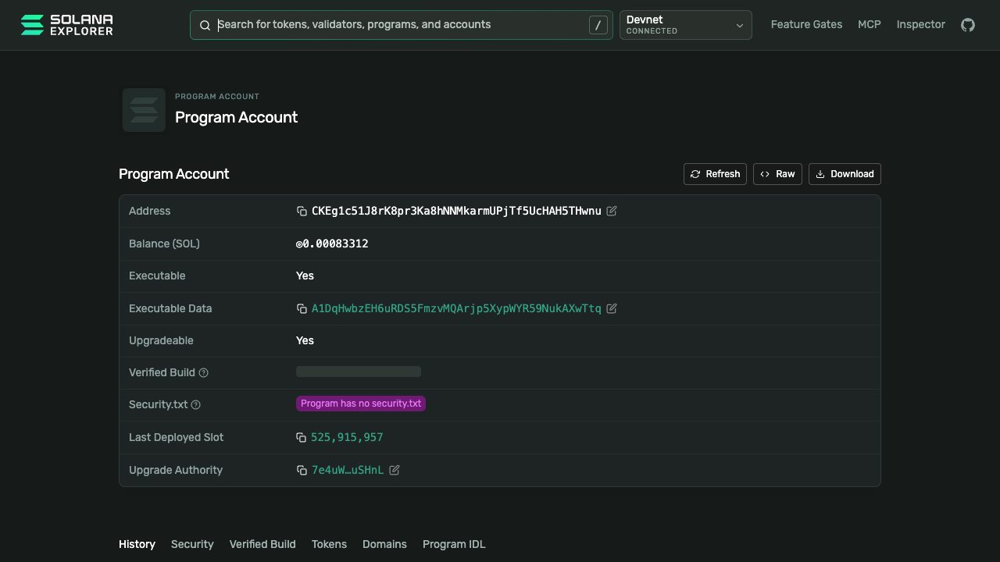<br><i>The deployed program on Solana Explorer (devnet)</i></p>

---

## Game modes and controls

Everything starts from **BEGIN YATRA**. A controls panel on the left side of every mode lists its keys; press **H** to hide or show it.

<table>
<tr><th>The Journey</th><th>Yuddha</th><th>Dharma Yuddha</th></tr>
<tr valign="top"><td>

| Key | Action |
|---|---|
| Arrows / WASD | Run |
| Shift | Sneak · hide in bushes |
| Enter (hold) | Shoot (auto-aim) |
| Space | Roll |
| Q | Brahmastra |

</td><td>

| Key | Action |
|---|---|
| WASD / arrows | Move |
| J / LMB | Light combo |
| K / RMB | Heavy (breaks guard) |
| L / Shift | Block · tap to parry |
| Space | Dodge |
| U / E | Astra special |
| I / Q | Ultimate |

</td><td>

| Key | Hidden move |
|---|---|
| 1 | **Strike** |
| 2 | **Heavy** |
| 3 | **Guard** |
| 4 | **Evade** |
| 5 | **Astra** (prana) |
| H | Hide panel |

</td></tr>
</table>

### Dharma Yuddha rules: who beats whom

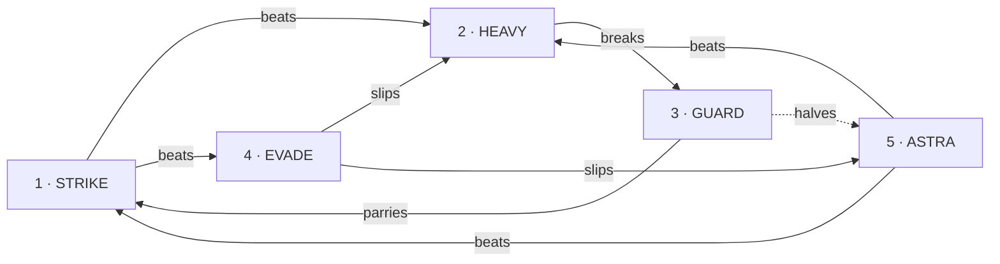

| Warrior | Army | HP | Strike | Heavy | Parry | Counter | Astra (cost) |
|---|---|---|---|---|---|---|---|
| **Angada** | Vanara Sena | 110 | 11 | 18 | 10 | 6 | Achala Pada 26 (60) |
| **Neela** | Vanara Sena | 100 | 12 | 17 | 7 | 9 | Shila Varsha 26 (50) |
| **Indrajit** | Rakshasa Sena | 95 | 10 | 16 | 7 | 7 | Naga Pasha 32 (50) |
| **Kumbhakarna** | Rakshasa Sena | 130 | 10 | 23 | 8 | 4 | Maha Gada 28 (70) |

How a beat resolves:
- **Damage:** same-move clashes (Strike/Strike, Heavy/Heavy, Astra/Astra) deal half damage to both.
- **Prana:** both players gain 15 prana every beat. Taking damage adds half the damage taken. If both players hold back (any mix of Guard and Evade), each gains +10 more.
- **Omen:** a VRF omen gives one side +25 starting prana.
- **Winning:** reduce the enemy to 0 HP. After 40 beats, the higher HP wins.

---

## Player flow

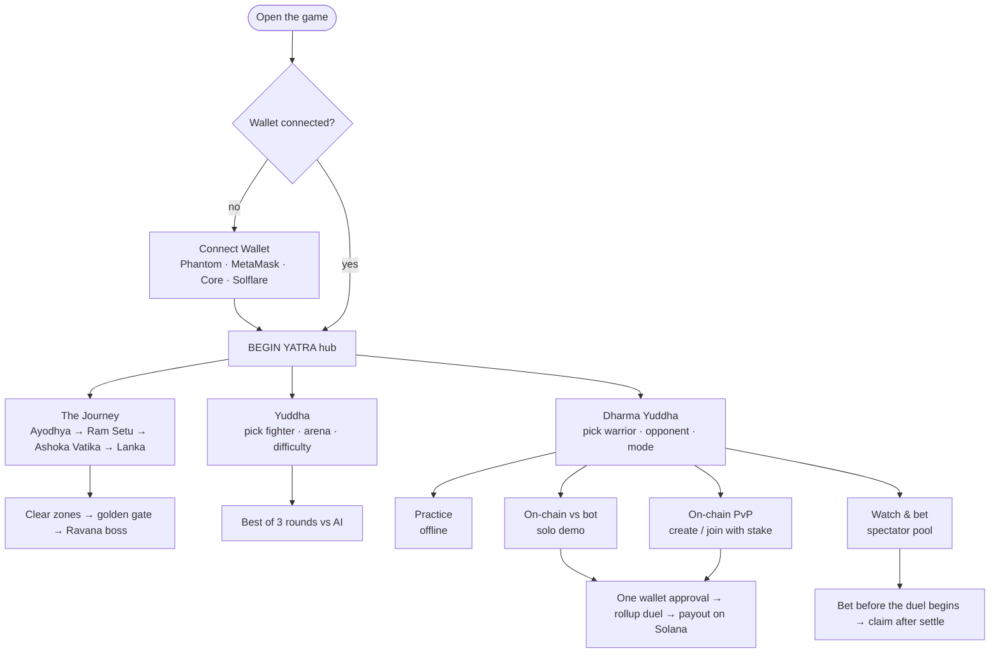

---

## Architecture

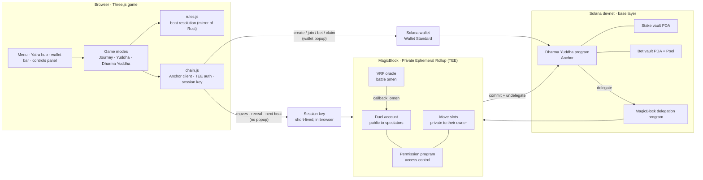

**Who signs what**

| Signer | Signs | Why |
|---|---|---|
| **Your wallet** (one popup) | `create_duel` / `join_duel` with stake + session-key funding + move-slot delegation, `place_bet`, `claim_bet` | Anything that moves your SOL or creates your accounts |
| **Session key** (no popups) | `begin_duel`, `init_permission`, `request_omen`, `make_choice`, `reveal_beat`, `next_beat`, `undelegate_all`, `claim_pot`, rent top-up, sweep | Fast gameplay. The program only accepts it for **your** side, and its leftover SOL is sent back to your wallet at the end |
| **Bot** (own keypair) | Its own join and moves | A real second on-chain identity for solo demos |

---

## On-chain duel lifecycle

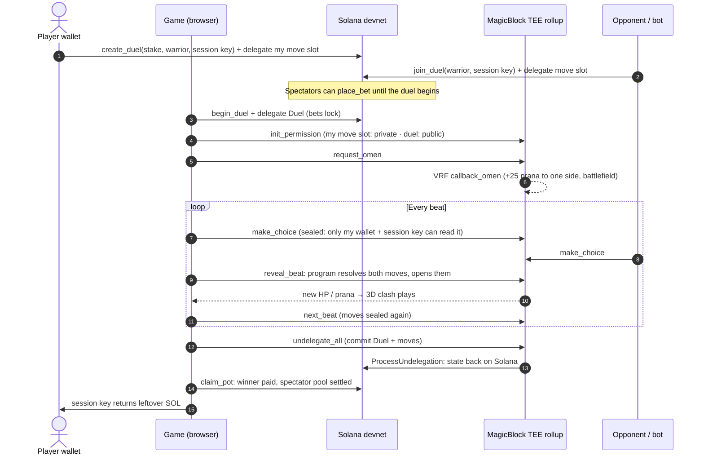

---

## Smart contract

`onchain/programs/dharma-yuddha/src/lib.rs` (Anchor 1.0.2, `ephemeral-rollups-sdk` with the `anchor`, `access-control` and `vrf` features).

### Accounts

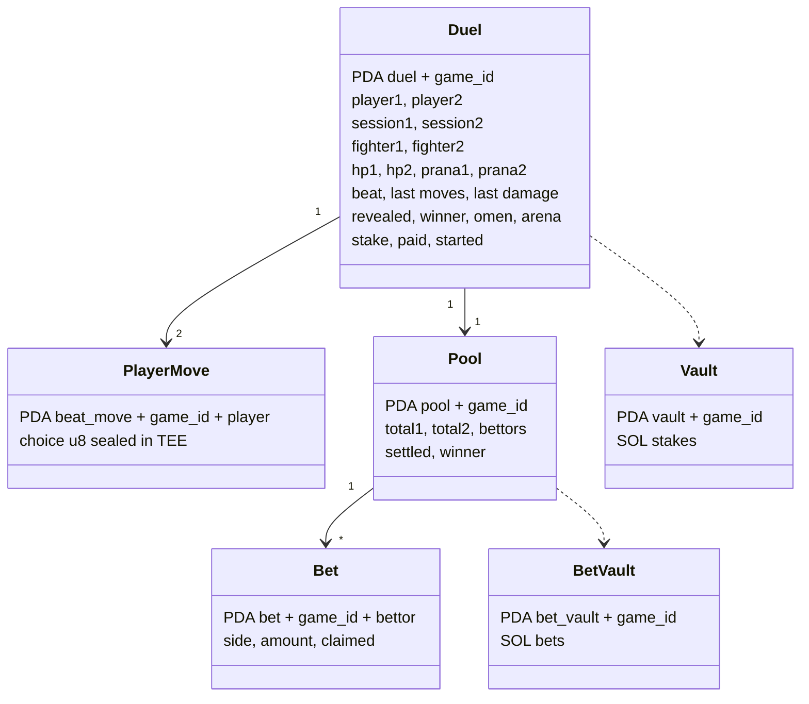

### Instructions

| Instruction | Layer | What it does |
|---|---|---|
| `create_duel` | Solana | Creates Duel, Pool, my move slot; stakes SOL; registers my session key |
| `join_duel` | Solana | Second warrior joins, matches the stake, registers their session key |
| `place_bet` | Solana | Spectator backs a side while the duel is still on the base layer |
| `begin_duel` | Solana | Starts the war; the client delegates the Duel in the same tx (bets lock) |
| `delegate_pda` | Solana | Delegates the Duel / a move slot to the TEE validator |
| `init_permission` | Rollup | Move slot private to its owner; Duel public to spectators |
| `request_omen` → `callback_omen` | Rollup | VRF picks a blessed side and the battlefield |
| `make_choice` | Rollup | Locks a hidden move (wallet or its session key only; astra checks prana) |
| `reveal_beat` | Rollup | Resolves both moves on-chain, makes them readable |
| `next_beat` | Rollup | Clears and re-seals the moves for the next beat |
| `claim_timeout` | Rollup | A player who moved wins if the opponent stalls for more than 90 s |
| `undelegate_all` | Rollup | Commits Duel + moves back to Solana once decided |
| `claim_pot` | Solana | Pays the winner (refund on draw) and settles the spectator pool |
| `claim_bet` | Solana | Stake back + pro-rata share of the losing side |
| `cancel_duel` | Solana | Refund if nobody joined |

---

## Proof: live on Solana devnet

All **43** transactions that touch the program on devnet succeeded. Here is one complete duel, recorded in the gameplay video:

| Step | Instruction(s) | Transaction |
|---|---|---|
| Program deployed | BPF upgradeable loader | [`fY6yL8wL…JdEAP`](https://explorer.solana.com/tx/fY6yL8wLQYppCDAtasB5PGNchQxAeCjDNaUFAG3MyBb9aHX48Q4KqNkJheYAJqotnbsnd7wV2ZNEHBC5gSJdEAP?cluster=devnet) |
| ① Create duel | `CreateDuel` + `DelegatePda` | [`RymDW9aW…rjy`](https://explorer.solana.com/tx/RymDW9aWndR5gHer6C9DFSGVEBvLLj3zoqQKUD7DngKHm71dogwrCdy8LxpoVPfByUcDn9NAwpCtpmm8oj3nrjy?cluster=devnet) |
| ② Opponent joins | `JoinDuel` + `DelegatePda` | [`4na3YMS8…pAnF`](https://explorer.solana.com/tx/4na3YMS8Jz7W69FXjVfKXm33y4b1R3mApH5YhQwtQh5UVuCXVuL6EzTnVG2n7wb1AhrjSxhv7P3wGAC3ej6JpAnF?cluster=devnet) |
| ③ Begin → private rollup | `BeginDuel` + `DelegatePda` | [`5zJioUHi…pUcLa`](https://explorer.solana.com/tx/5zJioUHiegDkGt6nLTcqmHNeYKPWA3jhzaJ2k9dMkYne1BsRfcCBPJ9p981S8m6P6bKyryxQe31K83mJn1HpUcLa?cluster=devnet) |
| ④ Beats (13) | `make_choice` / `reveal_beat` / `next_beat` | On the MagicBlock TEE rollup (private by design; shown in the in-game log) |
| ⑤ Rollup commits back | `ProcessUndelegation` | [`5FLtd8eV…3ptv`](https://explorer.solana.com/tx/5FLtd8eV9mXmiAMsxHepqwwwnriBZNfd7ZHAPYHTTdYjUZVu2AY3kUmPF145RkC7jBBnGpmRa9eXg6gZRw253ptv?cluster=devnet) |
| ⑥ Payout + pool settled | `ClaimPot` | [`51h2JFfo…AsjS`](https://explorer.solana.com/tx/51h2JFfoZmgeNMpWptiwgLmBbHQf4WjUvGCnLvGB6pz3xQrz1DmgXV9suNDSWybdcVfMFXby61dMQ9wiekz3AsjS?cluster=devnet) |

What was checked on devnet while building:
- **Privacy:** the opponent's move slot could **not** be read before `reveal_beat`.
- **VRF:** the oracle answered `callback_omen` (bonus prana and the battlefield were set).
- **Rules:** beat damage matched the rules exactly (e.g. Strike vs Heavy: Indrajit 95 → 84).
- **Settlement:** after the KO, the duel was back on Solana, the pot was paid, the pool was settled and the session SOL was returned.

---

## Fairness, privacy and security

- **Hidden moves:** each move slot is a delegated PDA with a TEE permission whose only members are the owner's wallet and session key. No one else can read it, not even through the RPC, until the program itself opens it in `reveal_beat`.
- **The program is the referee:** damage, prana, astra cost and the winner are computed on-chain in `resolve_beat`. The browser's `rules.js` only predicts the animation, and tests keep the two in agreement.
- **Session keys are limited:** `make_choice` accepts the session key only for its own side (`Duel::side_of`). It can't move the other player's slot or touch the stake vault. Its leftover SOL is swept back to the wallet.
- **No stalling:** `claim_timeout` gives the win to the player who moved if the opponent doesn't move for 90 s.
- **Betting closes on begin:** `place_bet` needs the Duel to be on the base layer and not yet started; delegating it locks the pool. Payouts are pari-mutuel; draws and sides nobody backed are refunded.
- **Devnet only:** this build uses test SOL. Real-money wagering would need a legal review per region.

---

## Run it yourself

```bash
npm install
npm run dev            # http://localhost:5173
npm run test:rules     # JS rules tests
```

Build and deploy the program (Rust, Solana CLI 3.1.9, Anchor 1.0.2):

```bash
solana config set --url devnet
npm run chain:test     # Rust rules tests
npm run chain:build    # anchor build + copy IDL to src/duel/idl/
npm run chain:deploy
```

The on-chain modes switch on automatically once the IDL is present and the program is live on devnet. Set your wallet to **Devnet**; the wallet bar's **+ SOL** button requests devnet test SOL.

Every push to `main` builds and publishes the game to GitHub Pages (`.github/workflows/pages.yml`).

---

## Repository map

```
.
├── index.html                  # menu, Yatra hub, wallet bar, HUDs, Dharma Yuddha UI
├── src/
│   ├── main.js                 # game loop, modes, Yuddha duel, camera, HUD
│   ├── characters.js           # procedural Rama, ten-headed Ravana, rakshasas + move data
│   ├── fighter.js · ai.js      # real-time fighter state machine and AI
│   ├── animation.js            # procedural pose animation
│   ├── arenas/                 # Ashoka Vatika, Ram Setu, Lanka, Ayodhya
│   ├── adventure/              # The Journey: zones, stealth AI, Ravana boss, minimap
│   ├── duel/
│   │   ├── roster.js           # Angada, Neela, Indrajit, Kumbhakarna models + stats
│   │   ├── rules.js            # beat resolution (mirror of the Rust rules)
│   │   ├── mode.js             # Dharma Yuddha lobby, HUD, 3D beats, controllers
│   │   ├── chain.js            # Anchor client, TEE auth, session keys, transactions
│   │   ├── wallet.js           # Solana Wallet Standard (Phantom, MetaMask, Core…)
│   │   └── idl/                # program IDL
│   ├── ui/                     # wallet bar, controls panel
│   ├── vfx.js · audio.js       # GPU particles, synthesized sound and music
├── onchain/programs/dharma-yuddha/src/lib.rs   # the Anchor program
├── tests/rules.test.js         # rules tests (JS)
└── docs/screenshots/           # images in this README
```

---

## Respecting the epic

Dharma Yuddha uses only **warriors of the two armies (Angada, Neela, Indrajit, Kumbhakarna)** and never the revered central figures. Its battlefields leave out **Ram Setu**, whose stones carry Rama's name. Staking and betting only ever involve these side warriors.

---

## Roadmap

1. Sculpted characters and motion-captured Kalaripayattu animation.
2. More warriors (Sugriva, Jambavan, Prahasta) and arenas (Kishkindha, Dandaka forest).
3. Real-time PvP with rollback netcode for Yuddha.
4. SOAR leaderboards and seasonal tournaments; cosmetic skins only, never pay-to-win.
5. Mainnet with audited payouts.

<div align="center">

**Built for Solana Blitz v10 · Solana × MagicBlock**

</div>
